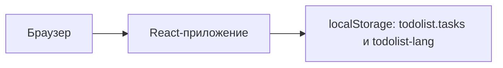

# Задачи

Личный список дел в браузере: добавить задачу, отметить её и вернуться к списку позже. Данные остаются на этом устройстве.

## Live Demo

https://kartuznik.github.io/todolist_test/

## Технологический стек

- React 18 и TypeScript (`strict`, без `any`)
- Vite 6, базовый путь `/todolist_test/`
- Обычный CSS, без UI-библиотек
- Шрифт Inter (латиница и кириллица) в репозитории, лицензия SIL OFL (`src/assets/fonts/OFL.txt`)
- Сборка публикуется через GitHub Actions на GitHub Pages

## Реализованные возможности

- Язык по умолчанию — русский. Переключатель **RU / EN** хранит выбор в `localStorage` (`todolist-lang`). Неверное значение сбрасывается на `ru`. Заголовок вкладки и meta description меняются вместе с языком.
- Добавление задачи: кнопка превращается в поле, Enter сохраняет обрезанный текст, пустая строка не сохраняется, Escape и клик снаружи отменяют ввод.
- Отметка выполнения и возврат в активные, удаление, фильтры «все / активные / готовые».
- Счётчики выполненных и оставшихся задач и подпись «Всего: N» / «Total: N».
- Тонкая полоса прогресса: доля выполненных, 0 при пустом списке.
- Короткое появление задачи, смена цвета зачёркнутого текста и выход при удалении. При `prefers-reduced-motion: reduce` анимации отключаются, удаление происходит сразу.
- Список задач в `localStorage` (`todolist.tasks`). Повреждённый JSON или неверная форма данных дают пустой список и не роняют страницу.
- Под списком три неинтерактивные карточки: Календарь, Приоритеты, Аналитика, с бейджем «СКОРО» / «SOON». Заголовка секции нет.
- На узком экране фильтры переносятся, у кнопок и поля ввода высота не меньше 44px, длинное слово в задаче не растягивает страницу.

## Локальный запуск

```bash
git clone https://github.com/kartuznik/todolist_test.git
cd todolist_test
npm install
npm run dev
```

Откройте http://localhost:5173/todolist_test/.

## Продакшен-сборка

```bash
npm run build
npm run preview
```

`npm run build` запускает `tsc --noEmit`, затем Vite. Результат — каталог `dist/`. Просмотр: http://localhost:4173/todolist_test/.

## Автопубликация через GitHub Actions

Файл `.github/workflows/deploy.yml` запускается на push в `main`.

1. Job `build` на `ubuntu-latest`: `actions/checkout@v4`, `actions/setup-node@v4` (Node 22), `npm ci`, `npm run build`, затем `actions/upload-pages-artifact@v5` с путём `dist`.
2. Job `deploy` зависит от `build` и вызывает `actions/deploy-pages@v5` в окружении `github-pages`.
3. Права workflow: `contents: read`, `pages: write`, `id-token: write`, `actions: read`. Параллельные деплои одной группы `pages` не отменяются.

Один раз в репозитории: **Settings > Pages > Source: GitHub Actions**. Подробности проверки, повтора и отката — в [docs/RUNBOOK.md](docs/RUNBOOK.md).

## AI-инструменты

Интерфейс собран в Cursor cloud agent. Координацию вёл ассистент Grok Bot.

## Паспорт

- **Уровень сложности:** не Level 1–3. Это статический фронтенд, не бот и не агент.
- **Статус:** `active` как публичное демо.
- **Ценность:** один экран, чтобы записывать дела и видеть, сколько уже сделано, без сервера и аккаунта.

## О проекте

### Что умеет

Только то, что перечислено в «Реализованные возможности».

### Чего не умеет

- Нет аккаунтов, синхронизации между устройствами и серверной базы.
- Нет Docker, API, платежей, мониторинга и алертов.
- Карточки «Календарь», «Приоритеты» и «Аналитика» ничего не открывают.
- Это portfolio MVP, не enterprise и не multi-tenant SaaS.

## Архитектура



## Self-heal и деградация

Внешних API нет, фоновой проверки здоровья нет, контейнер сам не перезапускается. Если `localStorage` недоступен или `todolist.tasks` повреждён, список в памяти пустой, страница остаётся рабочей.

## Демо

Ожидаемые кадры описаны в [docs/demo/README.md](docs/demo/README.md): `ru-desktop.png`, `en-desktop.png`, `ru-mobile.png`. Самих изображений в репозитории нет.

## Переменные окружения

Нет. Приложению не нужен `.env`.

## Мониторинг и backup

Отдельных портов мониторинга нет. Локальные порты разработки: Vite `5173`, preview `4173`. Как публиковать, проверить workflow и откатиться — в [docs/RUNBOOK.md](docs/RUNBOOK.md). Отдельного серверного backup нет: данные только в браузере пользователя.

## Актуальность

Дата актуализации: 2026-11-07. Отдельного `CHANGELOG.md` нет; история изменений — `git log`. Операционные шаги — в [docs/RUNBOOK.md](docs/RUNBOOK.md).

## FAQ

**Это сервис с аккаунтом?** Нет. Список живёт в браузере.

**Почему адрес заканчивается на `/todolist_test/`?** Так задан `base` Vite, чтобы сборка открывалась на GitHub Pages.

**Что будет с битым `localStorage`?** Приложение откроется с пустым списком.

**Можно ли выключить анимации?** Да. Системная настройка `prefers-reduced-motion: reduce` убирает их, удаление остаётся мгновенным.

**Нужен ли Docker?** Нет.

## Лицензирование и коммерческое использование

Базовая лицензия репозитория — **MIT** (см. [LICENSE](LICENSE)): код можно изучать, форкать и запускать у себя.

Коммерческие условия и редакции **Starter**, **Team** и **Custom** доступны по запросу. Конкретные цены в этом репозитории не хранятся.

| Редакция | Состав |
|---|---|
| **Community (MIT)** | Этот статический список дел, self-host или GitHub Pages |
| **Starter** | Community и помощь с однократным показом |
| **Team** | Отдельная договорённость, в этом репозитории админки нет |
| **Custom** | Индивидуальный scope вне текущего кода |

## License

MIT — см. [LICENSE](LICENSE).
