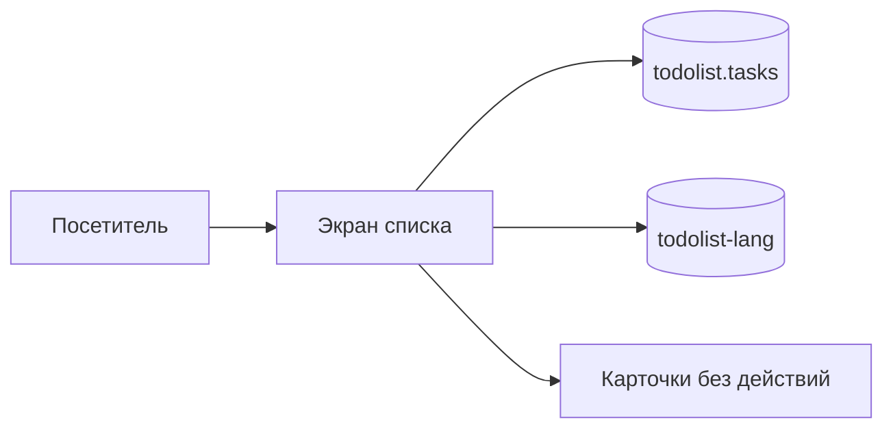

# Задачи

[](https://react.dev/)
[](https://www.typescriptlang.org/)
[](https://vite.dev/)
[](https://kartuznik.github.io/todolist_test/)
[](LICENSE)

**Личный список дел в браузере: добавить, отметить и вернуться позже. Без бэкенда и без регистрации.**

| Паспорт | |
| --- | --- |
| **Уровень** | Level 1 — линейный список, без агента, без LLM и без бэкенда |
| **Статус** | active — опубликовано на GitHub Pages |
| **Ценность** | Один экран, чтобы записывать дела и видеть, сколько уже сделано |
| **Актуализация README** | 2026-11-07 · [история коммитов](https://github.com/kartuznik/todolist_test/commits/main) |

Живой сайт: **https://kartuznik.github.io/todolist_test/**

Публикация и откат описаны в [docs/RUNBOOK.md](docs/RUNBOOK.md). Workflow: [`.github/workflows/deploy.yml`](.github/workflows/deploy.yml).

---

## О проекте

**Задачи** (репозиторий `todolist_test`) — **portfolio / static MVP**. Человек ведёт короткий список дел в браузере. Сервер автора текст задач не получает.

### Что это

Один экран личной продуктивности. Язык по умолчанию русский, рядом переключатель английского. Задачи и выбранный язык лежат в `localStorage`: `todolist.tasks` и `todolist-lang`. Первое открытие показывает пустой список и предлагает добавить задачу.

### Что умеет

- Добавить задачу, отметить её выполненной и вернуть обратно, удалить.
- Фильтры «все», «активные» и «готовые».
- Счётчики и полоса прогресса: доля выполненных, ноль на пустом списке.
- Русский и английский интерфейс. Неверное значение языка читается как русский.
- Три карточки под списком: Календарь, Приоритеты, Аналитика. Это рисунок, не кнопки.

### Чего не умеет (честный scope)

- Нет бэкенда, базы, аккаунтов и синхронизации между устройствами.
- Нет аналитики, трекеров, оплаты и SLA. Это не production-ready enterprise.
- Карточки под списком ничего не открывают.
- Нет мультипользовательности и ролей.
- Конкретные коммерческие цены живут **вне** git.

### Поведение при сбоях (graceful degradation)

- **Битый JSON или неверная форма `todolist.tasks`:** список читается как пустой. Страница не падает.
- **`localStorage` недоступен или переполнен:** список остаётся в памяти вкладки. После обновления страницы несохранённый список пропадёт.
- **Пустая строка или одни пробелы:** задача не добавляется, поле ввода остаётся открытым.
- **Незнакомое значение `todolist-lang`:** интерфейс на русском, в хранилище записывается `ru`.
- **Сеть пропала после загрузки:** уже открытая страница работает дальше. Первая загрузка с GitHub Pages без сети невозможна. Запасного хоста нет.

---

## Быстрый старт

```bash
git clone https://github.com/kartuznik/todolist_test.git
cd todolist_test
npm install
npm run dev
```

Нужен Node.js 22, как в workflow публикации. Открывать сайт можно и без клона: https://kartuznik.github.io/todolist_test/

Локальный адрес: http://localhost:5173/todolist_test/

### Ролевые порты

| Роль | Порт |
| --- | --- |
| Сайт | своего порта нет: статические файлы на GitHub Pages |
| API, база, мониторинг | нет |

---

## Путь пользователя

1. Открыть страницу. Список пуст, кнопка предлагает добавить задачу.
2. Кнопка становится полем. Enter сохраняет обрезанный текст. Escape или клик снаружи отменяют ввод.
3. Отметить задачу или удалить её. Фильтр показывает все, только активные или только готовые.
4. Полоса под счётчиками показывает долю выполненных.
5. **RU / EN** меняет подписи. Текст уже сохранённых задач не меняется.
6. Под списком три карточки с бейджем «СКОРО». Нажатия у них нет.

---

## Возможности

### Для пользователя

- Пустой первый заход и понятная подсказка добавить первую задачу.
- Поле ввода вместо кнопки, отказ от пустой строки, отмена по Escape и по клику снаружи.
- Зачёркивание выполненной задачи и короткое исчезновение при удалении. Если в системе включено `prefers-reduced-motion: reduce`, удаление сразу, без анимации.
- Счётчики «выполнено» и «осталось», подпись «Всего: N».
- Переключатель языка в правом верхнем углу. Выбор остаётся в этом браузере.

### Для владельца

- Сервер владельца текст задач не собирает и не хранит.
- Отдельной админки, метрик и списка чужих списков нет.
- Публикация — статический каталог `dist` на GitHub Pages.

---

## Архитектура



Экран собран в `src/App.tsx`. Список и фильтры считает `src/hooks/useTasks.ts`. Чтение и запись `todolist.tasks` — в `src/utils/storage.ts`. Строки интерфейса — в `src/i18n/ru.ts` и `src/i18n/en.ts`.

### Поток данных

1. Человек открывает страницу. Хук читает `todolist.tasks`. Битая запись даёт пустой массив.
2. Новая задача обрезается и дописывается в конец списка, затем список пишется в `localStorage`.
3. Отметка и удаление меняют тот же массив и ту же запись.
4. Фильтр выбирает, какие строки показать. Сам список в хранилище не режется.
5. Язык читается из `todolist-lang` и пишется туда же. На текст задач это не влияет.
6. Другое устройство и другой браузер эту запись не видят.

---

## Демо

Файлов в репозитории пока нет. Ожидаемые кадры перечислены и в [docs/demo/README.md](docs/demo/README.md):

| Плейсхолдер | Сценарий |
| --- | --- |
| `docs/demo/ru-desktop.png` | русский экран на широком окне: список и три карточки |
| `docs/demo/en-desktop.png` | тот же экран на английском |
| `docs/demo/ru-mobile.png` | русский экран около 375px, карточки столбиком |

---

## Переменные окружения

| Переменная | Обязательна | Назначение |
| --- | --- | --- |
| — | — | Продукту переменные окружения не нужны. Секретов в репозитории нет |

Файл `.env` для запуска не требуется.

---

## Установка и деплой

### GitHub Pages

Пуш в `main` запускает [workflow](.github/workflows/deploy.yml): `npm ci`, `npm run build` (сначала `tsc --noEmit`, затем Vite), публикация `dist` через `actions/upload-pages-artifact@v5` и `actions/deploy-pages@v5`. Отдельного `workflow_dispatch` в файле нет. Тестов в workflow нет. Адрес: https://kartuznik.github.io/todolist_test/

Docker Compose у проекта нет: серверного процесса нет, собирать контейнер не из чего.

Как проверить прогон, повторить его и откатить коммит — в [docs/RUNBOOK.md](docs/RUNBOOK.md).

### Локальный запуск

```bash
npm install
npm run dev
npm run typecheck
npm run build
npm run preview
```

`npm run build` сначала проверяет типы, затем собирает статику в `dist/`. Просмотр: http://localhost:4173/todolist_test/

---

## Мониторинг

Prometheus, Grafana, команды `/health` и фонового опроса нет. Единственный сигнал публикации — зелёный прогон GitHub Actions.

Серверных данных нет, поэтому серверный backup не нужен. Копия списка живёт в браузере человека. Шаги публикации и отката — в [docs/RUNBOOK.md](docs/RUNBOOK.md).

---

## Решение проблем

| Симптом | Что проверить |
| --- | --- |
| Стили и скрипты не загрузились | адрес должен заканчиваться на `/todolist_test/`. Это `base` в `vite.config.ts` |
| После `npm run preview` пустой корень порта | открывать `/todolist_test/`, не `/` |
| Deploy в Actions падает с 404 | **Settings > Pages > Source** должен быть **GitHub Actions** |
| Список пропал после обновления страницы | запись в `localStorage` была битой или хранилище было недоступно. Серверной копии нет |
| Сайт не обновился сразу после пуша | дождаться job `deploy`. Следующий пуш текущий деплой не отменяет: в workflow `cancel-in-progress: false` |
| Язык сам стал русским | в `todolist-lang` было не `ru` и не `en` |

---

## FAQ

**Q: Это бесплатно?**
A: Да. Оплаты внутри продукта нет. Сайт на GitHub Pages открывается без аккаунта.

**Q: Как запустить у себя?**
A: `git clone`, `npm install`, `npm run dev`. Свой адрес на GitHub Pages — форк и тот же workflow. Отдельный сервер не нужен.

**Q: Можно ли использовать для клиентов?**
A: Код под MIT можно поднять у себя. Сопровождение и отдельные условия — по запросу, вне этого репозитория. См. [лицензирование и коммерческое использование](#лицензирование-и-коммерческое-использование).

**Q: Это production-ready enterprise?**
A: Нет. Это portfolio / static MVP: один статический сайт и список в браузере.

**Q: Куда деваются введённые задачи?**
A: В `localStorage` браузера. Автору они не отправляются.

**Q: Нужна ли регистрация?**
A: Нет.

**Q: Есть ли тесты?**
A: Нет. См. [тестирование](#тестирование).

---

## Тестирование

Отдельного тест-раннера нет: в `package.json` нет `npm test` и нет Vitest. Проверка перед публикацией — `npm run build`. Внутри него `tsc --noEmit` и сборка Vite. Workflow выполняет тот же `npm run build` и тесты не запускает.

---

## AI-инструменты

Интерфейс собран в Cursor cloud agent. Координацию вёл ассистент Grok Bot.

---

## Лицензирование и коммерческое использование

Базовая лицензия репозитория — **MIT** (см. [LICENSE](LICENSE)): код можно изучать, форкать и запускать self-hosted.

Коммерческие условия и редакции **Starter**, **Team** и **Custom** доступны **по запросу через контакт** (условия и коммерческие материалы — вне этого репозитория).

Кратко по составу возможностей (без коммерческих цифр):

| Редакция | Состав (ориентир) |
| --- | --- |
| **Community (MIT)** | Self-host статический список дел: задачи в браузере, два языка, публикация на Pages |
| **Starter** | Community + сопровождение однопользовательского демо |
| **Team** | Starter + правка текстов интерфейса по договорённости. Админки в этом репозитории нет |
| **Custom** | Свой домен, дополнительные экраны, локализованная документация под клиента |

Конкретные цены и коммерческие условия живут **вне** продуктового git.

## License

MIT — см. [LICENSE](LICENSE).

## Авторы

- [kartuznik](https://github.com/kartuznik)
